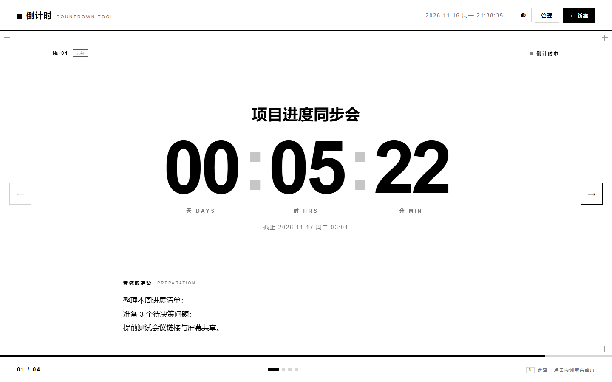
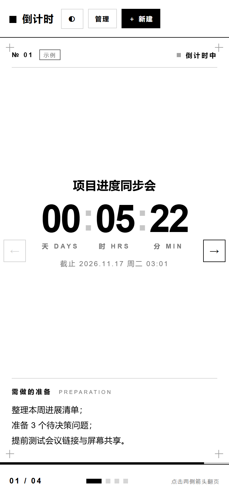
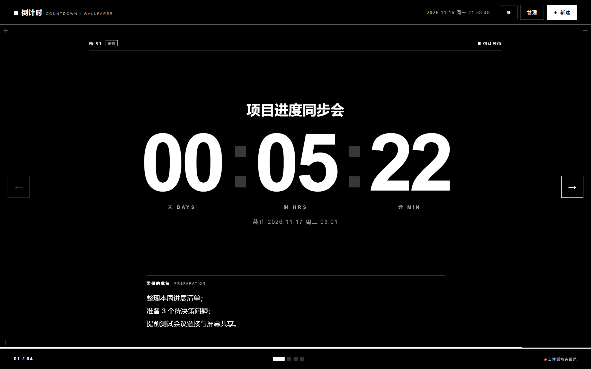

# 倒计时 · Swiss Countdown

黑白极简、瑞士国际主义风格的倒计时工具，也可用作 Windows 交互桌面壁纸。
**单个 HTML 文件、零依赖、零网络请求**——双击即用。

| 手机端 | 壁纸模式 |
| --- | --- |
|  |  |

## 功能

- **倒计时**：填入事项与截止时间，剩余时间以大字号显示（天 / 时 / 分），每秒走动；到期后自动翻转为「已到期」反色卡片，显示已过时间。
- **自动排序**：最急迫的事项永远排第一；截止时间相同的事项每次加载随机先后。
- **一页一事**：每页只呈现 剩余时间（大字号）＋ 事项名称（中字号）＋ 需做的准备（中字号），标题居中于时间上方。点击两侧箭头按钮翻页。
- **多端适配**：手机竖屏 / 小屏 320px / 横屏 / 桌面宽屏各自优化排版，无溢出。
- **黑白反色**：一键切换黑底白字。
- **壁纸模式**：字号整体放大、关闭多余动效，适合长时间挂在桌面；在 Lively 的 WebView2 环境中自动开启，也可用 `todo.html#wp` 强制开启。
- **管理**：新建 / 编辑 / 删除（可撤销）/ 一键清空（可撤销）/ JSON 导出备份 / 导入恢复；快捷截止时间 chips（+1 小时 / +1 天 / +3 天 / +1 周 / +30 天）。
- **键盘**：`N` 新建事项。

## 使用

### 网页 / 手机

双击 `todo.html` 用浏览器打开即可；放到任意静态托管（GitHub Pages、Netlify 等）后手机访问同一地址。
数据保存在浏览器本地 `localStorage`，不上传、不联网。

### Windows 桌面壁纸（Lively Wallpaper）

1. 安装免费开源的 [Lively Wallpaper](https://github.com/rocksdanister/lively)。
2. 把本仓库目录（或单独的 `todo.html`）拖入 Lively 添加为壁纸；`LivelyInfo.json` 是 Lively 的项目描述文件。
3. 壁纸模式自动生效：黑底、加大字号、低开销（实测空闲约占单核 0.8%，即 32 核整机的 0.02%）。
4. 翻页点击屏幕两侧箭头按钮。

## 文件

| 文件 | 说明 |
| --- | --- |
| `todo.html` | 全部功能所在的全部代码（HTML/CSS/JS 单文件） |
| `LivelyInfo.json` | Lively 壁纸项目描述（相对路径，可直接导入） |
| `preview-*.png` | 桌面 / 手机 / 壁纸模式预览图 |

## 隐私

所有事项数据仅存于本机浏览器 `localStorage`；无统计、无外部请求、无第三方依赖。
首次打开载入 4 条虚构示例事项，可在「管理」中编辑或清空。

## 技术

原生 HTML/CSS/JS，无框架无构建。排版遵循瑞士国际主义：12 栏网格参考线、Helvetica 系字阶、直角与硬阴影、黑白单色系统。